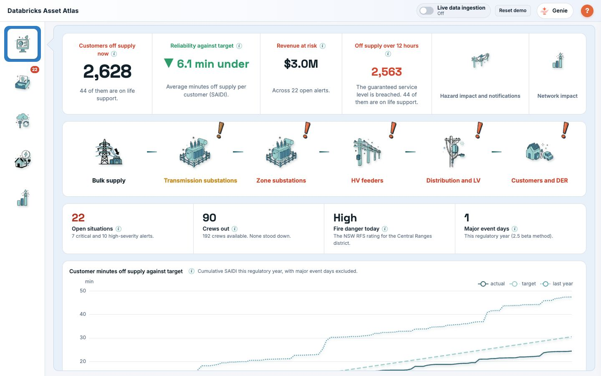
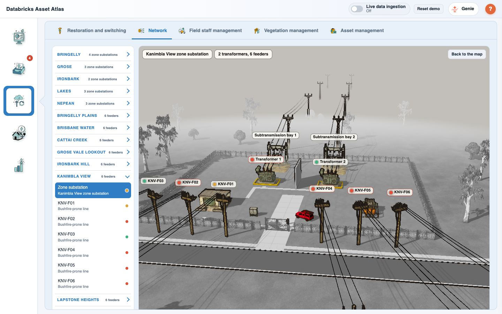
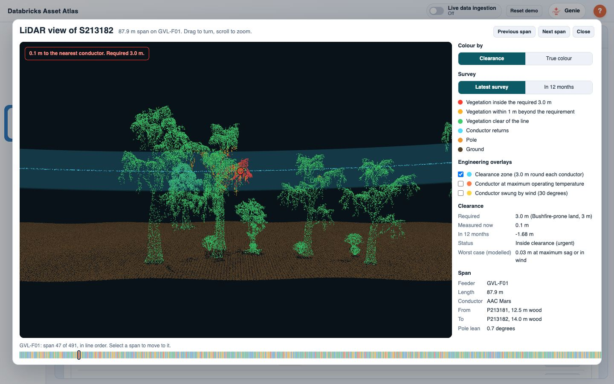
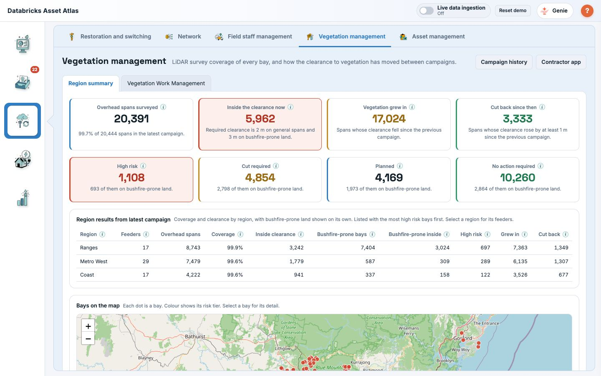
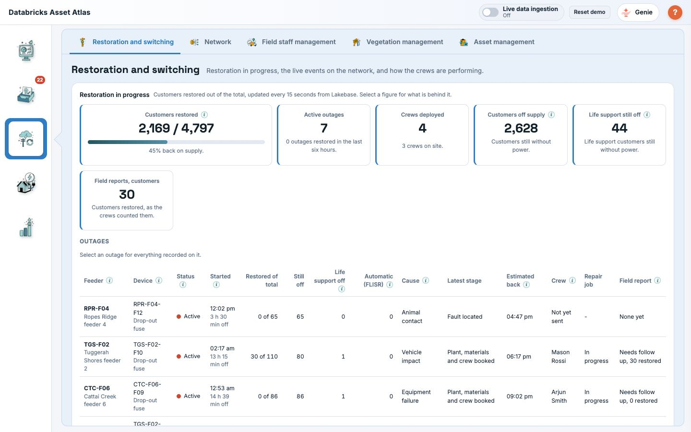
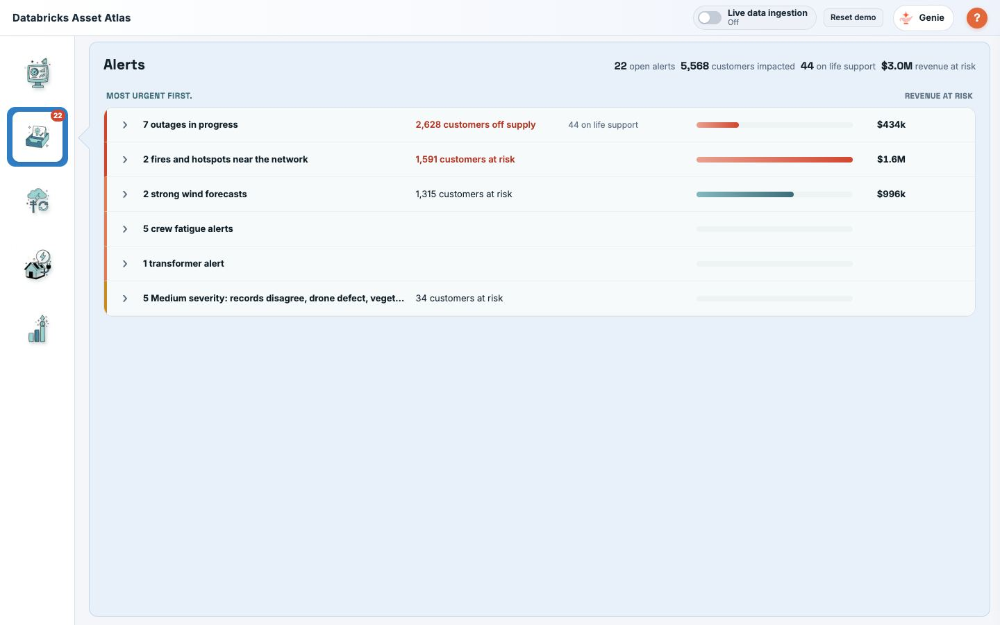
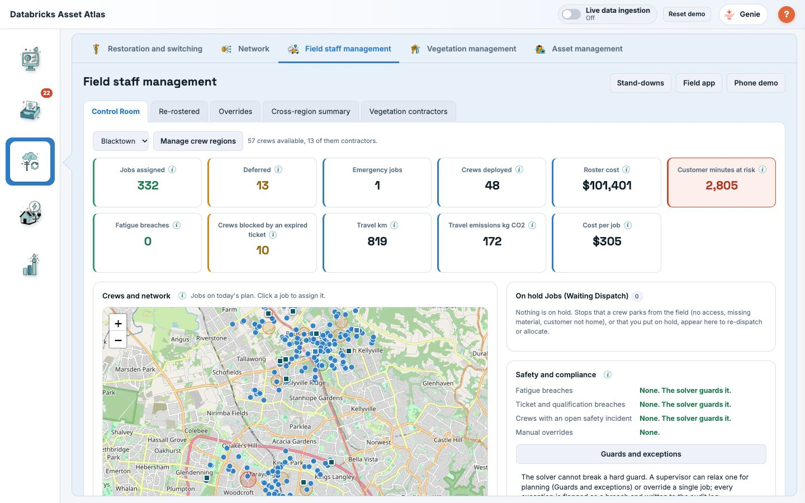
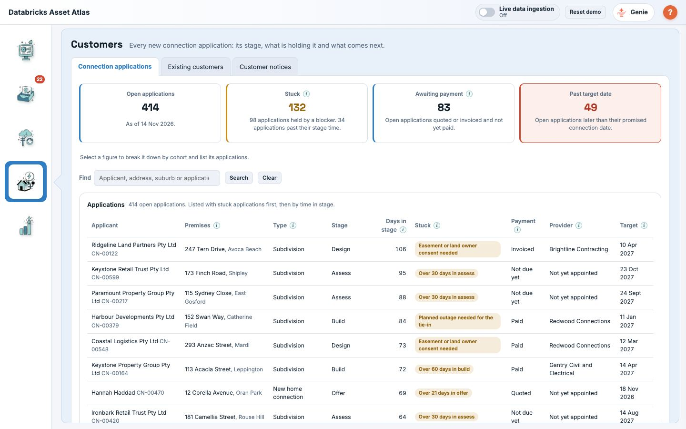
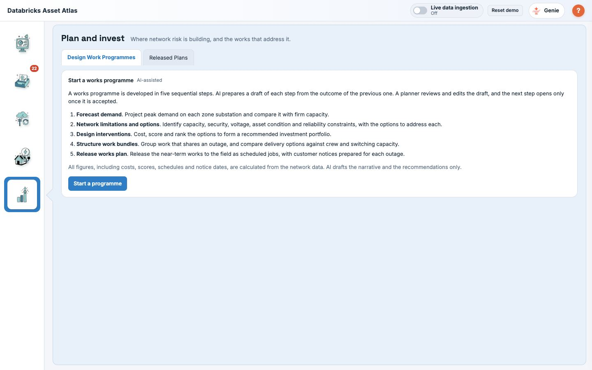
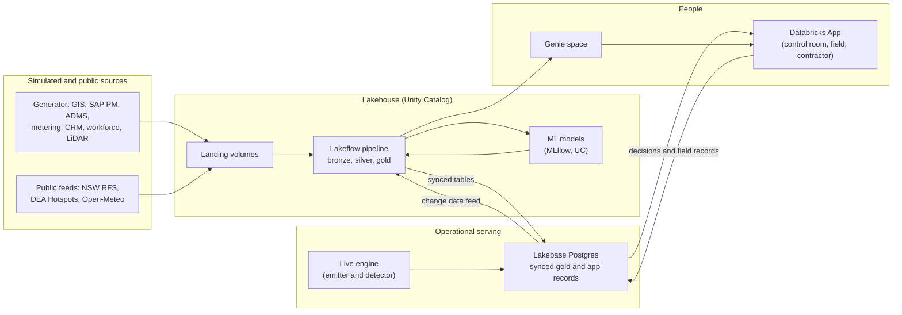

**CONFIDENTIAL: Databricks Internal**

# Asset Atlas, Electricity Distribution

A digital twin of an electricity distribution network, built entirely on Databricks. It follows a fictional distributor over real
New South Wales geography, from bulk supply points and zone substations down to feeders, poles, meters and customers. It lets
control room, field, vegetation, asset, customer and planning teams work from one governed copy of the network and its data.

Everything you see comes from one deployment. It is a Databricks App backed by Lakebase Postgres, a Lakeflow pipeline
(bronze, silver, gold), MLflow models, a Genie space and live public feeds. All of it is installed with a single command.



## What it shows

| Screen | What you can do there |
|---|---|
| **Command Centre** | See customers off supply, reliability against target, revenue at risk and the state of each stage of the network, from bulk supply to customers. |
| **Alerts** | Work through situations raised by the live engine (outages, fires, wind, transformer gas, crew fatigue and more), each with its impact and recommended actions. |
| **Operations** | Five tabs: restoration and switching, the network (map and 3D site views of every site), field staff management, vegetation management (with a LiDAR point cloud of every span) and asset management. |
| **Customers** | Follow new connection applications through their stages, and look up any existing customer, how their premises is supplied and the calls they made. |
| **Plan and Invest** | Draft a network investment programme with AI help: demand forecast, constraints, options, bundles, then release the near-term works to the field. |
| **Field app** | A phone app for crews: their day's stops, field reports and asset photos (`/field`). |
| **Contractor app** | A phone app for vegetation contractors: their bays, cut photos and exceptions, working offline (`/contractor`). |
| **Genie** | Ask questions of the gold layer in plain English, from the button at the top right. |
| **Behind the scenes** | Hover the question mark at the top right of any screen to see the data path behind it, from the source systems to the API calls it just made. |

<p>




</p>

<p>




</p>

## How it fits together



The app reads and writes only Lakebase: gold tables are synced into it, and the app's own records (situations, decisions, field
work, vegetation, notices) live there. Lakebase's change data feed copies those records back into the lakehouse, where the pipeline and
Genie read them. See [the architecture guide](docs/architecture.md) for each component.

## Deploy it

You need the [Databricks CLI](https://docs.databricks.com/aws/en/dev-tools/cli/install) (0.283 or later) and python3 on your machine.
The workspace needs Unity Catalog, serverless compute, Databricks Apps, Lakebase and the Foundation Model API.

```bash
./deploy.sh --host https://<workspace-url> --catalog <catalog> [--schema <schema>]
```

- The first deploy builds everything from scratch in about 35 minutes and prints the app's address at the end.
- `--schema` defaults to `atlas_electricity`. The catalog and schemas are created if they do not exist.
- The deploy picks the newest Claude models the workspace can use and fixes them in the app's configuration.
- Running the same command again redeploys the code in about 6 minutes.

The [deployment guide](docs/deployment.md) covers every option, what each step does, and what to do when a workspace refuses something.

## Remove it

```bash
./cleanup.sh --host https://<workspace-url> --catalog <catalog> [--schema <schema>]
```

It removes everything the deploy created for that deployment and nothing else. It asks you to type the deployment name first.

## Test it

```bash
python3 tests/e2e.py --app https://<app-url> --profile <cli-profile> --keep-going
```

About 150 end-to-end checks against a running deployment, grouped by screen (`--only network,vegetation` runs a few groups). See
[the development guide](docs/development.md).

## Repository layout

| Folder | What it holds |
|---|---|
| `app/` | The Databricks App: FastAPI back end (`*.py`, `rm/`) and the vanilla JavaScript front end (`static/`). |
| `pipelines/` | The Lakeflow pipeline: bronze, silver and gold, with the customer, planning, vegetation and finance marts. |
| `generator/` | The synthetic network and its source systems, written in each system's native format, with its reference geography. |
| `serving/` | Lakebase DDL, the list of gold tables synced into Lakebase, and the Genie space builder. |
| `ops/` | Lakebase setup and sync, and the live engine (emitter, storyline and situation detector). |
| `ml/` | Model training, registration and scoring. |
| `feeds/` | The public feed puller. |
| `config/` | The network configuration and the weather history the generator and models use. |
| `tests/` | The end-to-end test suite. |
| `tools/` | The phone demo relay and the reference geography builder (local only, not deployed). |
| `deploy.sh`, `cleanup.sh`, `deploy_lib.sh`, `databricks.yml` | The one-command deploy and cleanup, and the Databricks Asset Bundle they drive. |

## Data and attributions

- **The network, customers and operations are synthetic.** The distributor is fictional; any resemblance to a real network is
  coincidental.
- **Live public feeds:**
  - [NSW Rural Fire Service](https://www.rfs.nsw.gov.au/news-and-media/stay-up-to-date/feeds) major incidents and fire danger ratings;
  - [Digital Earth Australia Hotspots](https://hotspots.dea.ga.gov.au/);
  - [Open-Meteo](https://open-meteo.com/) forecasts and historical weather (CC BY 4.0).
- **Maps:** tiles from [OpenStreetMap](https://www.openstreetmap.org/copyright) contributors.
- **Reference geography:**
  - addresses use the [Australian postcodes dataset](https://github.com/matthewproctor/australianpostcodes) (built from Australia Post and ABS data);
  - elevation uses the [AWS terrain tiles](https://registry.opendata.aws/terrain-tiles/).
- **3D models and icons** were generated for this project with [Meshy](https://www.meshy.ai/).

## Documentation

- [Deployment guide](docs/deployment.md): prerequisites, options, the steps, model selection, removal and troubleshooting.
- [Architecture guide](docs/architecture.md): the components, the data flow, the Lakebase and Unity Catalog schemas, and the jobs.
- [Development guide](docs/development.md): running the tests, how the code is organised, and the conventions to keep.
