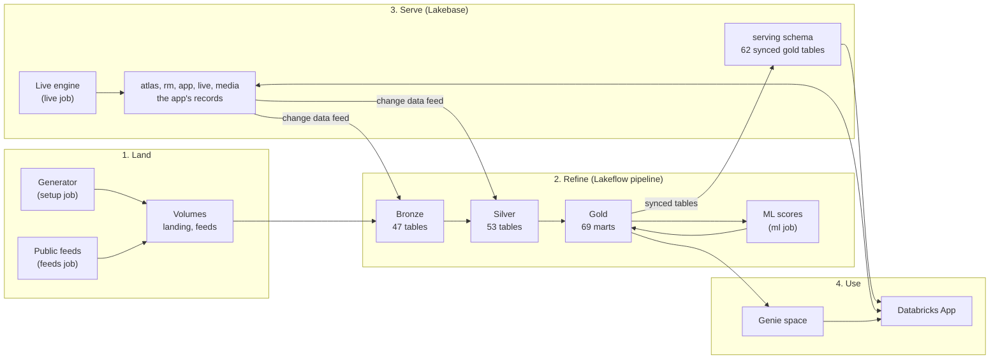

**CONFIDENTIAL: Databricks Internal**

# Architecture guide

Asset Atlas is one Databricks deployment with two sides: an analytical lakehouse and an operational database. They are joined
in both directions:
- **Analytical side (Unity Catalog):** the source systems land, are refined and become gold.
- **Operational side (Lakebase Postgres):** the app reads synced gold and keeps its own records.
- **Gold to Lakebase:** synced tables carry gold into Lakebase.
- **Lakebase to the lakehouse:** the change data feed carries the app's records back into the lakehouse.

## The app

A [Databricks App](https://docs.databricks.com/aws/en/dev-tools/databricks-apps/): a FastAPI back end serving a front end written
in plain JavaScript modules, with no build step.

- **Back end (`app/`).**
  - `main.py` mounts the routes. The feature modules (`views`, `situations`, `operations`, `customers`, `notify`, `planning`,
    `vegetation`, `assets`, `fieldreport`, `scene`) each keep their logic and their SQL; the `routes_*.py` files expose them.
  - `rm/` is field resource management: regions, crews, rostering, the dispatch solver and the field app's API.
  - `core.py` holds the shared plumbing: the Lakebase connection pool, cached queries, the audit log, the foundation model client,
    and starting the live and feeds jobs.
- **Front end (`app/static/`).**
  - `index.html` with one module per screen (`screens.js`, `ops.js`, `rm.js`, `vegetation.js`, `assets.js`, `customers.js`,
    `plan.js`, `notify.js` and others).
  - Shared helpers in `ui.js`, and plain-language help text in the `glossary*.js` files.
  - The 3D site views use Three.js with compressed GLB models (`models_web/`); maps use Leaflet with OpenStreetMap tiles.
- **Phone apps.** `/field` (crews) and `/contractor` (vegetation contractors) are small installable web apps served by the same
  app. The contractor app queues its actions offline and sends them in one `/api/vegetation/contractor/sync` call when it has a
  connection.
- **Identity.** The app runs as its own service principal, granted its Lakebase project, its SQL warehouse, its two jobs, its three
  model endpoints and its Genie space through the bundle. People sign in with their Databricks login. The contractor app has no
  sign-in of its own: the crew record names the actor on every write it makes.
- **Data access.** The app reads only Lakebase, through a connection pool using an OAuth database credential refreshed every
  30 minutes. It never writes to the lakehouse.
- **AI.** Three Foundation Model API endpoints, one per role (fast drafting and speech, planning, vision), chosen by the deploy (see
  [the deployment guide](deployment.md#choosing-the-ai-models)) and passed to the app as `ATLAS_LLM`, `ATLAS_LLM_PLAN` and
  `ATLAS_LLM_VISION`.

## Lakebase (the operational database)

Each deployment has its own [Lakebase](https://docs.databricks.com/aws/en/oltp/) project named after it, with PostGIS for the
spatial queries.

| Schema | Tables | What it holds | Fed to the lakehouse |
|---|---|---|---|
| `<schema>_serving` | 62 | Gold tables synced from Unity Catalog (snapshot sync), with PostGIS geography columns and indexes laid over them. The app's read model. | No (it comes from there) |
| `atlas` | 16 | Situations and their events, recommendations and decisions, customer notices and the outbox, live outages, asset photos, defect closures, planning programmes and releases, and the audit log. | Yes |
| `rm` | 15 | Field resource management: raised jobs, holds, stand-downs, overrides, field status, live crew positions, field reports, and the vegetation work packages, bay tasks, photos, completions, audits and reissues. | Yes |
| `live` | 3 | The raw live streams as they arrive: SCADA values, smart meter alarms and customer calls (recent hours only). | Yes |
| `app` | 7 | Working state: live snapshots and the engine's status, cache revisions, crew stop order, planning exceptions. | No |
| `media` | 1 | Photo bytes from the field and contractor apps. | No (the metadata in `atlas` and `rm` is) |

The DDL is in `serving/lakebase_*.sql`. The Lakebase step of every deploy runs it, with every table and column commented. The list
of synced gold tables is in `serving/tables*.py` (`SERVING`, with each table's primary key). A synced table no longer in the list is
removed on the next deploy.

## Unity Catalog (the lakehouse)

| Schema | What it holds |
|---|---|
| `<schema>` | The medallion: 47 bronze, 53 silver and 69 gold tables; four ML score tables (`ml_*`); `ref_label`, the reference table that turns every code into the words shown on screen; `share_historian_archive`, a year of 15-minute historian values in the shape a historian publishes over Delta Sharing; the `landing` and `feeds` volumes; and two registered models. |
| `<schema>_serving` | The Unity Catalog side of the synced tables. |
| `<schema>_lb_atlas`, `_lb_rm`, `_lb_live` | The change data feed's history tables (`lb_<table>_history`), one per Lakebase table. Created only when the feed is set up. |

### The sources (generator and feeds)

The setup job builds a deterministic network from `config/atlas.json`: areas, zone substations, feeders, transformers, poles, spans,
meters and customers over real NSW geography. It then writes each source system in its own native format into the `landing` volume:

| Source system | Format |
|---|---|
| GIS | A GeoPackage with WKB geometry in GDA2020. |
| SAP Plant Maintenance | Equipment, notifications and orders as ODQ delta extracts, with change modes. |
| Network connectivity model | CIM XML, one file per zone substation. |
| ADMS | Outage and open-outage JSON. |
| Metering | NEM12 interval files and meter voltage. |
| Market and CRM | NMI standing data, the life support register, critical sites and contact preferences. |
| Distributed energy | The DER register and public charging sites. |
| Asset surveys | LiDAR span clearances by campaign, and drone patrol detections (COCO). |
| Workforce and works | Crews, skills, tickets, leave, training, depots, vehicles, enterprise agreement rules, safety events and work orders. |
| New connections | Connection cases and their stage events. |

The feeds job pulls the real public feeds into the `feeds` volume, keeping every raw payload:
- NSW RFS major incidents and fire danger ratings;
- DEA satellite hotspots over the footprint;
- the Open-Meteo 72-hour forecast on a grid.

### The pipeline

One serverless Lakeflow pipeline (`pipelines/*.py`) builds everything:

- **Bronze** ingests each source as it landed, with Auto Loader for the streaming drops. It also ingests the live streams from the
  change data feed's history.
- **Silver** types, cleans and conforms each source:
  - SAP extracts are applied with automatic change data capture;
  - GIS features become a connected network;
  - the app's own records become current-state tables (`slv_app_*`) from their change history.
- **Gold** builds the marts the app, the models and Genie read:
  - asset and network state, the feeder trace, reliability and outages;
  - vegetation risk, fire exposure, defects and works;
  - crews and field dispatch, customers, notices and new connections;
  - planning (zone demand, constraints, interventions, bundles) and finance.

Every gold table and column carries a comment.

### The models

The ML job (`ml/train_score.py`) trains and registers two models in Unity Catalog with MLflow, then scores them:
- **storm impact:** feeder-day faults, customers interrupted and crew-hours, with a P10 to P90 range;
- **span fault risk:** the chance a span faults in the year.

It also forecasts zone load with AI Functions (`ai_forecast`). The scores land in `ml_*` tables, which the pipeline's planning marts and
the app read.

## The jobs

| Job | When it runs | What it does |
|---|---|---|
| setup | By the deploy (first time, or `--rebuild`) | Generates the network, the source files and the history. |
| public feeds | When live ingestion is switched on in the app | Pulls the public feeds every minute for 55 minutes. |
| ML | By the deploy | Trains, registers and scores the models. |
| live | When live ingestion is switched on (it switches off after 60 minutes) | The live engine: emits SCADA, meter and call events, plays the storyline, trips feeders and runs the situation detector. |
| serving | By every deploy | Lakebase setup (DDL, grants, change data feed), the gold sync into Lakebase, and the Genie space. |
| medallion (pipeline) | By the deploy | Bronze, silver and gold. |

All of them run on serverless compute and are defined in `databricks.yml`.

## The live engine and situations

The live engine (`ops/live.py`) runs as a time-boxed job while live ingestion is on:
- **Every tick** it writes the latest state into Lakebase: feeder and zone loads, crew positions and live outages.
- **Every raw record** goes into the `live` schema: SCADA values, smart meter alarms and customer calls.
- **Every few minutes** it trips a feeder on its own.
- **When it is switched off**, it writes what it holds and stops.

The situation detector (`ops/detector.py`) reads gold, the ML scores, the live feeds and Lakebase, and raises situations:
- fires and hotspots near the network;
- strong wind forecasts;
- transformer gas and loading;
- minimum system load;
- vegetation readiness;
- drone-detected defects;
- meter records against the wrong transformer;
- crew fatigue.

Trips raise their own situation as they happen, and overdue emergency jobs raise one too. Each situation type has its own detail view
in `app/situations.py`.

## Genie

The serving job creates (or updates) a Genie space titled `Asset Atlas, Electricity (<name>)`, with:
- 50 tables: gold, the ML scores, `ref_label`, and the live and app silver tables;
- instructions and example questions.

It grants the app's service principal access, and the app opens it from the Genie button. The tables built from the app's own records
are filled only when the change data feed is set up.

## Round trip of a decision

When a controller accepts a recommendation, the app writes the decision to `atlas.recommendation` and the audit log in Lakebase. The
screen shows it at once. The change data feed then carries the change to `<schema>_lb_atlas.lb_recommendation_history` within about
15 seconds. On its next run, the pipeline turns it into `slv_app_recommendation` and the `gld_situation_decision` mart, which Genie
can answer questions about.
